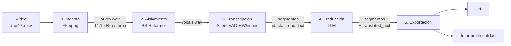
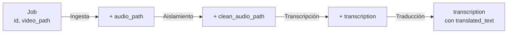
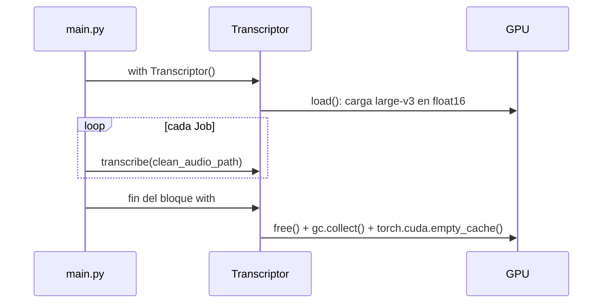
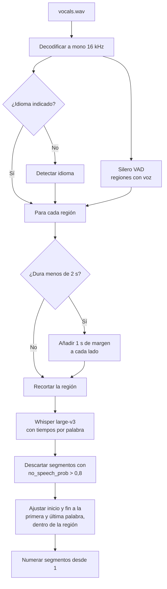
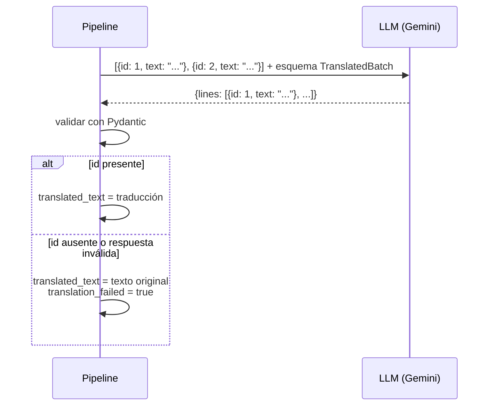

# Cómo funciona

## Visión general

Cada vídeo pasa por cinco fases. Lo que viaja entre fases son archivos en disco (audio) y una lista de segmentos en memoria (texto con tiempos).

## Fases horizontales

El pipeline no procesa un vídeo de principio a fin y luego el siguiente. Procesa todos los vídeos en una fase y solo entonces pasa a la siguiente.

```mermaid
flowchart TB
    subgraph H ["Horizontal (lo que se hace)"]
        direction LR
        HA["Cargar Roformer"] --> HB["Aislar vídeo 1, 2, 3"] --> HC["Liberar Roformer"]
        HC --> HD["Cargar Whisper"] --> HE["Transcribir vídeo 1, 2, 3"] --> HF["Liberar Whisper"]
    end
    subgraph V ["Vertical (lo que se evita)"]
        direction LR
        VA["Roformer: vídeo 1"] --> VB["Whisper: vídeo 1"] --> VC["Roformer: vídeo 2"] --> VD["Whisper: vídeo 2"] --> VE["..."]
    end
```

Con tres vídeos, el orden vertical carga seis modelos; el horizontal, dos. No hay paralelismo: hay una sola GPU y cada fase recorre los vídeos uno detrás de otro. Lo que se ahorra son las cargas y descargas de modelos, y con ellas el riesgo de quedarse sin VRAM. El porqué está en [Decisiones técnicas](../decisiones.md#fases-horizontales).

### El objeto `Job`

Para no perder la relación entre un vídeo y sus archivos intermedios, cada vídeo tiene un `Job` (`src/models.py`) que cada fase va completando:

Cada fase recibe la lista completa de `Job` y la devuelve con un campo más.

### Un modelo en VRAM a la vez

Las fases con modelo (`Isolator`, `Transcriptor`) heredan de `Model` y se usan como gestor de contexto. Al salir del bloque `with` se libera el modelo, se ejecuta el recolector de basura y se vacía la caché de CUDA.

## Fase por fase

### 1. Ingesta

`src/ingestion/extract.py`

Primero se comprueba con `ffprobe` que el vídeo tiene pista de audio. Después FFmpeg la extrae a WAV PCM 16 bits, estéreo, 44,1 kHz. Se mantiene la calidad original porque es lo que espera BS Roformer; la conversión a mono 16 kHz se hace más tarde, justo antes de Whisper.

Los archivos intermedios van a `TEMP_PATH/<nombre del vídeo>/`.

### 2. Aislamiento de voz

`src/isolation/isolate.py`

BS Roformer (`model_bs_roformer_ep_368_sdr_12.9628.ckpt`, a través de `audio-separator`) separa la pista en voz e instrumental. Se conserva la voz y se borra el resto. Quitar la música y los efectos reduce las frases inventadas por Whisper en zonas sin diálogo.

### 3. Detección de voz y transcripción

`src/transcription/transcriptor.py`

Es la fase con más lógica propia:

Puntos clave:

- El VAD es el de Silero que trae faster-whisper (`get_speech_timestamps`). Parámetros: umbral 0,65, voz mínima 250 ms, silencio mínimo 500 ms, margen 100 ms, región máxima 25 s.
- Whisper transcribe cada región por separado. Así los tiempos quedan anclados a la región y el error no se acumula a lo largo del vídeo.
- Las regiones cortas (menos de 2 s) reciben 1 s de audio extra a cada lado para que Whisper tenga contexto. El resultado se recorta luego a la región original.
- Los tiempos del subtítulo salen de la primera y la última palabra, no del segmento de Whisper, que suele empezar antes de que se hable.
- `condition_on_previous_text=False` evita que un error en una región se arrastre a la siguiente.

El resultado es una lista de `TranscriptionSegment`: `id`, `start`, `end`, `text`.

### 4. Traducción

`src/translation/translator.py`

Al LLM no se le pide un SRT, sino que traduzca una lista JSON y devuelva otra con los mismos `id`:

Los tiempos nunca pasan por el LLM, así que no puede desplazarlos. Si falta una línea, el subtítulo sale en el idioma original y queda marcado para el informe.

El proveedor se elige en `.env` (`LLM_PROVIDER`, `LLM_MODEL`, `API_KEYS`) y lo crea `TranslatorFactory`. Ahora mismo solo existe `google` (Gemini). `TranslatorFactory` crea un traductor por clave y los envuelve en `RotatingTranslator`, que las usa por turnos. Si una petición falla (error de la API o de red) pasa a la siguiente clave tras una espera. Si se acumulan `MAX_CONSECUTIVE_ERRORS` fallos seguidos, todas las líneas del vídeo se quedan en el idioma original con `translation_failed` y el pipeline continúa. Los reintentos internos del SDK están desactivados para no duplicarlos. Cada vídeo se envía completo en una sola petición; `batching.py` tiene un esbozo de lotes que todavía no se usa.

### 5. Exportación e informe

`src/export/exporter.py`, `src/evaluation/`

Se escribe un `.srt` junto al vídeo de origen usando los tiempos de la transcripción y el texto traducido. Después se evalúa cada subtítulo con las reglas descritas en [Calidad](../calidad.md) y se imprime una tabla con el tiempo de cada fase.

## Estructura del código

| Módulo | Contenido |
|---|---|
| `src/main.py` | Orquestador: crea los `Job` y ejecuta las fases en orden |
| `src/config.py` | Configuración desde `.env` |
| `src/models.py` | `Job`, `TranscriptionSegment` y la clase base `Model` |
| `src/ingestion/` | Extracción de audio |
| `src/isolation/` | BS Roformer |
| `src/transcription/` | VAD y Whisper |
| `src/translation/` | Traductores por proveedor y lotes |
| `src/export/` | Escritura de `.srt` |
| `src/evaluation/` | Métricas, reglas e informe de calidad |
| `scripts/evaluate.py` | Evaluar cualquier `.srt`, `.ass` o `.vtt` desde la terminal |
