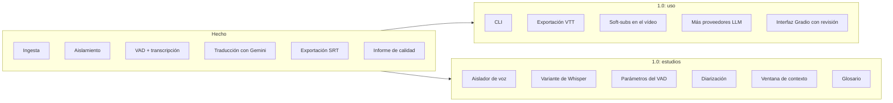

# Hoja de ruta

## Objetivo de la versión 1.0

La 1.0 cierra el proyecto. Tiene dos partes: hacerlo usable sin tocar el código y justificar con datos las elecciones de modelos y técnicas.

## Hecho

- Extracción de audio con FFmpeg.
- Aislamiento de voz con BS Roformer.
- VAD y transcripción por regiones con faster-whisper `large-v3`.
- Traducción con Gemini, salida JSON por id y respaldo al texto original si falla.
- Exportación a `.srt`.
- Informe de calidad al final de cada ejecución y `scripts/evaluate.py` para evaluar cualquier subtítulo.

## 1.0: uso

- **CLI.** Indicar vídeos, idioma de destino y formato por argumentos en lugar de editar `main.py`.
- **VTT.** Exportar también a `.vtt`.
- **Soft-subs.** Meter el subtítulo en el `.mkv` o `.mp4` como pista seleccionable con FFmpeg, sin recodificar el vídeo.
- **Más proveedores LLM.** Añadir otros a `TranslatorFactory` (por ejemplo, un modelo local con Ollama, OpenAI o Cerebras).
- **Interfaz Gradio.** Subir vídeos, revisar y corregir los subtítulos antes de exportar.

## 1.0: estudios

Cada estudio compara opciones sobre el mismo conjunto de vídeos de prueba (inglés, japonés y español) usando el informe de calidad y una revisión manual. Lo que no mejore el resultado no se incorpora.

| Estudio | Opciones | Pregunta |
|---|---|---|
| Aislador de voz | BS Roformer, Demucs, MDX-Net, sin aislar | ¿Cuánto reduce las frases inventadas y a qué coste de tiempo? |
| Whisper | `large-v3`, `large-v3-turbo`, WhisperX | ¿Hay diferencia de calidad o solo de velocidad? |
| VAD | Umbral, márgenes, regiones cortas | ¿Dónde está el equilibrio entre frases inventadas y perdidas? |
| Diarización | Pyannote 3.1 o nada | ¿Mejora el género y el número en la traducción? ¿Compensa otro modelo pesado? |
| Ventana de contexto | Lotes con contexto previo o vídeo entero | ¿Hace falta con un LLM de contexto grande? ¿Y con uno local pequeño? |
| Glosario | Glosario automático o nada | ¿Mejora la coherencia de los nombres propios? |

Los resultados se publicarán en [Calidad](calidad.md).

## Fuera de la 1.0

- Perfiles para GPUs con menos VRAM (modelos más ligeros, sin Roformer).
- Subtítulos incrustados en la imagen (hard-subs).
- Ajustar la longitud de la traducción a los límites de lectura desde el propio LLM.
- Reagrupación semántica de los segmentos en frases completas.
